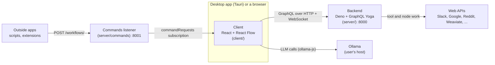

# Agentic Signal: Architecture

Agentic Signal is a visual workflow builder for local AI automation. Users connect nodes on a canvas: data sources, LLM steps running on their own Ollama models, tools, outputs. They run the result by hand, on a timer, from a Slack command, from the built-in AI Buddy chat, or from outside apps over HTTP.

This file is the high-level map. The [architecture/](architecture/) folder goes into each part, including step-by-step guides for [adding a node](architecture/nodes.md#adding-a-node) and [adding a tool](architecture/tools.md#adding-a-tool).

## The Running System

- **The client runs the workflows.** Execution lives in the node components: each node reacts to its input, does its work and hands an envelope to the nodes downstream ([client.md](architecture/client.md)). LLM calls go straight from the client to the user's Ollama host.
- **The backend does what a browser can't**: scraping with Playwright, OAuth-protected APIs, Slack Socket Mode, serial ports for SMS, the workflows folder on disk. It exposes GraphQL queries, mutations and WebSocket subscriptions on port 8000 ([server.md](architecture/server.md)).
- **Outside apps call workflows** on port 8001. The backend relays each call to the open app, which runs it on a listening layer and sends the result back ([commands.md](architecture/commands.md)).
- **The desktop app** is Tauri. It starts the compiled backend as a sidecar process and adds native features (file dialogs, OAuth windows) through Rust commands ([build-and-release.md](architecture/build-and-release.md)).

Both servers bind `127.0.0.1` by default. Docker sets `AGENTIC_SIGNAL_HOST=0.0.0.0`.

## Repository Map

| Path | What it holds |
|------|---------------|
| `client/` | The React app (Vite). Nodes in `client/src/components/nodes/`, tools in `.../nodes/ToolNode/tools/`. |
| `server/` | The Deno backend: `nodes/` and `tools/` (per-node and per-tool GraphQL modules), `workflows/`, `commands/`, `browser/` (app-level modules), `graphql/`, `ws/`. |
| `shared/` | Code both sides import: constants, utilities, and `types.gen.ts` (re-exports every server node's and tool's `types.ts`). |
| `src-tauri/` | The desktop shell (Rust): sidecar management, OAuth flows, Tauri commands per node or tool. |
| `scripts/` | Code generators (`generate-files.ts`) and the docs schema extractor. |
| `docs/` | The public documentation site (Docusaurus), deployed to agentic-signal.com. |
| `../agentic-signal-pro/` | A separate, private repo with the PRO nodes (Slack, SMS, Reddit). Its `link.sh` / `link.bat` symlink them into this repo's folders. |

## Core Concepts

| Concept | Where | In one line |
|---------|-------|-------------|
| **Node** | `client/src/components/nodes/<Name>Node/` (+ optional `server/nodes/`, `src-tauri/src/nodes/`) | A building block on the canvas, described by a `NodeDescriptor`. See [nodes.md](architecture/nodes.md). |
| **Tool** | `client/src/components/nodes/ToolNode/tools/<Name>/` (+ optional `server/tools/`) | A function an LLM node may call, plugged in through the generic AI Tool node. See [tools.md](architecture/tools.md). |
| **Envelope** | `client/src/types/workflow.ts` | What travels along an edge: `{payload, toolsPayload?, timerTrigger?}`. |
| **Ports** | `NodePorts` in `nodes/types.ts` | `flow` (data), `trigger` (Timer), `context` (RAG), `tool` (tools into LLM nodes). |
| **Workflow** | JSON with `nodes` and `edges` | What's saved and loaded. Secrets are stripped on save (`toSanitize`). |
| **Layer** | `client/src/context/LayersContext.tsx` | One open workflow. Several run at once. The read-only **AI Buddy layer** runs chat commands. |
| **Command** | Workflow Input / Workflow Output nodes | A workflow callable by name from the chat or over HTTP, routed by the `CommandRouter`. See [commands.md](architecture/commands.md). |
| **AI Buddy** | `client/src/components/Dock/components/AIAssistantDock/` | The chat assistant: builds workflows, runs commands. See [ai-buddy.md](architecture/ai-buddy.md). |
| **Global store** | `client/src/stores/globalConfig.ts` | App-wide key/value state. Shared secrets live here for the session; Settings → Credentials saves them encrypted in the vault. See [credentials.md](architecture/credentials.md). |

## Generated Code

Nodes and tools are found by folder. Nothing is registered by hand. `bun run precompile` (run by every dev and build script) executes `scripts/generate-files.ts`, which renders mustache templates into `*.gen.ts` files:

| Generated file | From |
|----------------|------|
| `client/.../nodes/nodeRegistry.gen.ts`, `nodeFactory.gen.ts`, `workflow.gen.ts` | every node folder with a `descriptor.ts(x)`, sorted by the descriptor's `order` |
| `client/.../ToolNode/tools/toolRegistry.gen.ts` | every tool folder with a descriptor |
| `server/nodes/nodesRegistry.gen.ts`, `server/tools/toolsRegistry.gen.ts` | every folder with a `mod.ts` |
| `shared/types.gen.ts` | every server node or tool folder with a `types.ts` |
| `src-tauri/src/main.gen.rs`, `nodes/mod.gen.rs`, `tools/mod.gen.rs` | every `#[tauri::command]` under `src-tauri/src/nodes` and `tools` |
| `docs/src/data/nodeSchemas.gen.json` | each node's zod schemas (`scripts/generate-docs-schemas.ts`, run by the docs' `bun run start`). Committed: the docs build and its CI deploy use the file as committed. |

Never edit a `*.gen.*` file. Change the template or the source folder instead.

## The Detailed Documents

| Document | Read it for |
|----------|-------------|
| [architecture/client.md](architecture/client.md) | The app shell, layers, the workflow engine, saving and loading, settings |
| [architecture/nodes.md](architecture/nodes.md) | Anatomy of a node, and **how to add one** |
| [architecture/tools.md](architecture/tools.md) | The AI Tool node, tool definitions, how LLM nodes call tools, and **how to add a tool** |
| [architecture/server.md](architecture/server.md) | The Deno backend: GraphQL assembly, subscriptions, app modules |
| [architecture/commands.md](architecture/commands.md) | Commands end to end: router, Workflow Input/Output, the chat, outside apps |
| [architecture/ai-buddy.md](architecture/ai-buddy.md) | The chat assistant: prompt, keywords, commands, rendering performance |
| [architecture/credentials.md](architecture/credentials.md) | The global store, shared secrets, sanitizing, Settings → Credentials |
| [architecture/build-and-release.md](architecture/build-and-release.md) | Dev setup, scripts, tests, code health, Tauri, Docker, CI, the docs site, the PRO repo |
