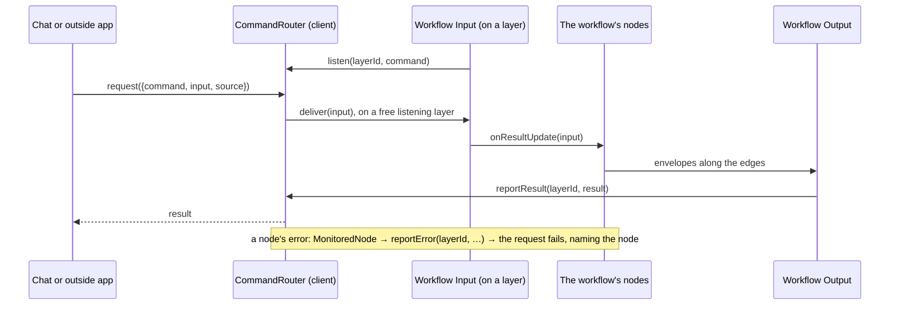
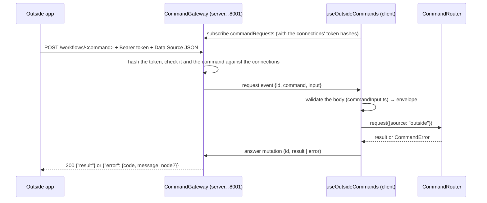

# Commands

A **command** is a workflow callable by name. The workflow starts with a Workflow Input node, which names the command, and ends with a Workflow Output node, which hands the result back. Two kinds of caller exist: the **AI Buddy chat** (`/research …`) and **outside apps** (`POST /workflows/research` on port 8001). One client-side `CommandRouter` serves both.

Back to the [overview](../ARCHITECTURE.md). User-facing docs: `docs/docs/getting-started/outside-apps.md`, `docs/docs/nodes/input/workflow-input.mdx`.

## End to End

## The Command Router

`client/src/services/commandRouter.ts`, one instance per app (`CommandRouter.getInstance()`). It holds:

- **listeners:** which layer listens for which command. A Workflow Input registers one with `listen(layerId, command, deliver, describe)` while it listens.
- **a slot per layer:** a layer serves one request at a time.
- **a FIFO queue:** requests wait there until a matching layer is free. Several layers may listen for one command, which makes a small worker pool.
- **the request ↔ layer link,** so nodes report by `layerId` and never see a request id.

`request({command, input, source, awaitNewListener?, signal?, queueTimeoutMs?, runTimeoutMs?})` returns a promise of the result envelope. It fails with a `CommandError`, whose `code` is one of:

| Code | When |
|------|------|
| `no_listener` | No layer of the right kind listens for the command. |
| `busy` | It waited longer than `queueTimeoutMs` (default 5 minutes) for a free layer. |
| `node_failed` | A node on the serving layer reported an error first. `error.node` names it. |
| `timeout` | The run took longer than `runTimeoutMs` (default 10 minutes). |
| `cancelled` | The caller's `signal` aborted: Stop in the chat, or an outside caller hanging up. |

**Who reaches which layers** (`source`):

- `"chat"` reaches only the AI Buddy layer;
- `"outside"` reaches only the user's layers, and only Workflow Inputs whose Run is on. There is no URL parameter to pick a layer.

**Reports with no open request are dropped.** That's what keeps layers apart: a Workflow Output or a failing node on a layer that serves nothing changes nothing. The first result or error settles the request, and later ones are ignored.

`getLayerState(layerId)` / `subscribe(listener)` expose `idle | serving | succeeded | failed` per layer. The layer switcher's status dot shows it (`hooks/useLayerCommandState.ts`).

## The Nodes

- **Workflow Input** (`nodes/WorkflowInputNode/`):
  - Listens while its Run is on, and always on the AI Buddy layer.
  - `deliver` puts the caller's input out as the node's output, which starts the workflow.
  - Its title shows `/command`.
  - `normalizeCommand` (`client/src/workflows/commands.ts`) defines valid names: lowercase letters, digits and hyphens.
- **Workflow Output** (`nodes/WorkflowOutputNode/`): an effect on its `input` calls `reportResult(layerId, input)`.
- **Errors:** every node built on `MonitoredNode` reports its new errors with `reportError(layerId, {nodeId, nodeType, nodeTitle, message})`.

## Calls from the Chat

`ChatPanel` sees a message starting with a known `/command`:

1. **Which workflow:** `hooks/useCommandWorkflows.ts` lists the built-in workflows (`client/src/workflows/builtin/*.json`) plus the saved workflows in the workflows folder that have a Workflow Input. A saved one overrides a built-in of the same name.
2. **Load it:** `useAiLayerRun` (`AIAssistantDock/hooks/`) loads the workflow onto the AI Buddy layer with `replaceWorkflow`. `withDefaultModel` first gives every LLM node with no model the chat's selected model.
3. **Run it:** `router.request({source: "chat", awaitNewListener: true, input: {payload: text}})`. With `awaitNewListener`, only a Workflow Input mounted after the request counts, so a listener from the workflow being replaced can't take it.
4. **Answer:** the AI Buddy writes its answer from the result (`commandReplySystemPrompt`). The result stays in the reply, folded away.

## Calls from Outside Apps

- **Connections** (Settings → Workflows) are kept in the global store with each token's SHA-256 (`tokenHash`); the tokens themselves are in the vault ([credentials.md](credentials.md#the-vault)). The client sends the server only the hashes, so calls work while the vault is locked, and resubscribes whenever the connections change.
- **`server/commands/service.ts`** (`CommandGateway`):
  - routes `GET /workflows` (list), `POST /workflows/<command>` (call), and `GET` / `DELETE /workflows/jobs/<id>` (async jobs);
  - maps error codes to HTTP statuses (`STATUS_BY_CODE`) and answers CORS preflights;
  - answers `app_not_open` (503) when no app is subscribed.
- **Async jobs:** a caller sending `Prefer: respond-async` gets `202 {job}` at once and polls the job. A job nobody checks on for 2 minutes is cancelled, and a finished one is kept for 10 minutes.
- **The input:**
  - The body must be a Data Source as JSON: `{type: "json", value}` or `{type: "markdown-and-files", value: {text, files}}`.
  - `client/src/services/commandInput.ts` validates it with zod, then builds the envelope with the Data Source node's own helpers (`buildDataSourceEnvelope`, `fileDataFromBytes`). So posted files come out exactly as attached ones would.
- **Network access:** `server/commands/listener.ts` rebinds port 8001 between `127.0.0.1` and `0.0.0.0` when Settings' switch changes. Running calls finish, and the choice is saved in `~/.agentic-signal/settings.json`. `AGENTIC_SIGNAL_COMMANDS_HOST` or `AGENTIC_SIGNAL_HOST` locks it.

## Known Limits

- A layer serves one request at a time. Running several commands at once in one layer would need results matched by layer and command.
- When a caller hangs up, its layer is freed, but nodes already running finish their work.
- Editing the outside connections while a call runs ends that call with `app_not_open`, because the app resubscribes.
- The Slack nodes don't use the router yet: Slack events go to every matching Slack Input.
